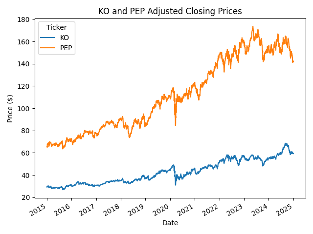
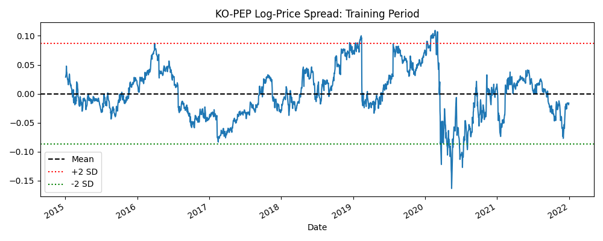
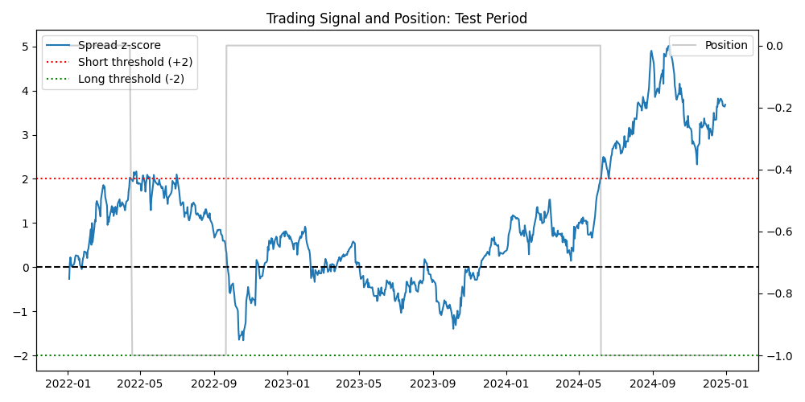
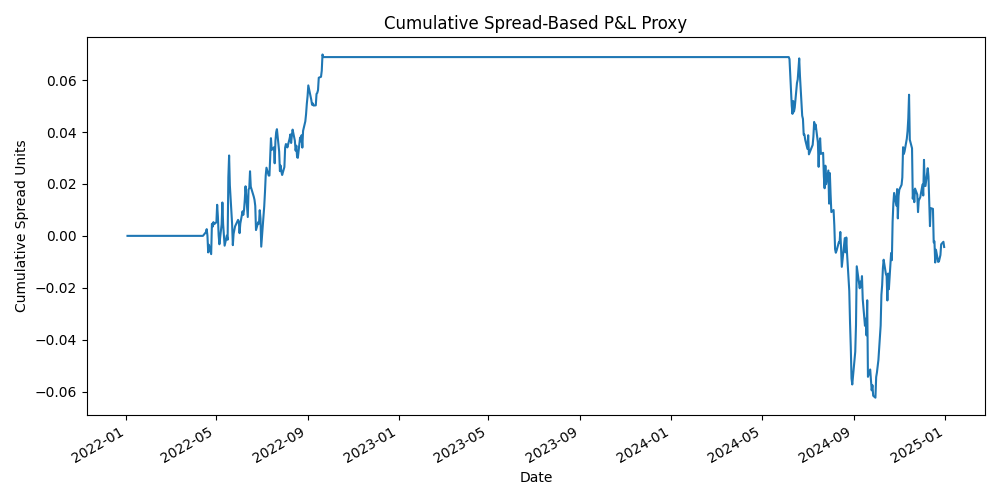

# KO-PEP Pairs Trading Backtest

This project tests whether Coca-Cola (KO) and PepsiCo (PEP) log prices were cointegrated between 2015 and 2021, then backtests a simple mean-reversion pairs-trading strategy out of sample from 2022 to 2025.

The in-sample relationship is statistically significant, but the strategy produces a small net loss after transaction costs, showing that cointegration alone does not guarantee profitable mean-reversion trading.

## Results

| Metric | Value |
| --- | --- |
| Cointegration statistic | -3.5764 |
| Cointegration p-value | 0.0262 |
| Out-of-sample cumulative P&L | -0.0043 units |
| Max drawdown | -0.1323 units |
| Trades executed | 3 |

The strategy entered only three trades over the out-of-sample period. With such a small sample the cumulative P&L should be interpreted as only an illustration of the strategy mechanics rather than a robust estimate of expected performance.


## Performance Visualisations

### Price Series & Cointegration Check
The strategy uses daily adjusted log prices for KO and PEP from 2015 to 2025:


### In-Sample Spread Estimation (2015-2021)
An OLS regression estimates the long-run relationship on the training period only:
$$ \ln(P_{KO, t}) = \alpha + \beta \ln(P_{PEP,t}) + \epsilon_t $$


### Out-of-Sample Trading Signals (2022–2025)
The in-sample spread mean ($\mu$) and standard deviation ($\sigma$) are used to compute out-of-sample z-scores. Positions are entered when the spread deviates materially from its training-period equilibrium and exited as it mean-reverts.



### Out-of-Sample Cumulative P&L
The equity curve includes a fixed transaction-cost penalty applied to each change in position turnover.



--

## Mathematical Framework & Methodology

### 1. Cointegration Test
Applied the Engle-Granger two-step cointegration test ('statsmodels.tsa.stattools.coint') on the in-sample log prices:
$$\text{Null Hypothesis } (H_0): \text{The log price series are NOT cointegrated}$$

A p-value of 0.0262 is below 5% significance level, so the null hypothesis of no cointegration is rejected. This provides evidence of a long-run equilibrium relationship between the two log-price series during the training period.

### 2. Hedge Ratio & Spread Model
Ordinary Least Squares (OLS) regression extracts parameters $\alpha$ and $\beta$:
$$\ln(P_{KO, t}) = \alpha + \beta \ln(P_{PEP, t}) + \epsilon_t$$

The spread $S_t$ and normalised z-score $Z_t$ are evaluated as:
$$S_t = \ln(P_{KO, t}) - \alpha - \beta \ln(P_{PEP, t})$$
$$Z_t = \frac{S_t - \mu_{train}}{\sigma_{train}}$$

### 3. Execution Rules
Positions are shifted by 1 period ($t+1$) to avoid look-ahead bias:

| Signal | Rule | Position |
| --- | --- | ---|
| Long Spread Entry | \(Z_t \le -2.0\) | Buy KO, sell PEP |
| Short Spread Entry | \(Z_t \geq +2.0\) | Sell KO, buy PEP |
| Long Spread Exit | \(Z_t \geq -0.5\) | Close position |
| Short Spread Exit | \(Z_t \leq +0.5\) | Close position |

## How to run

```bash
git clone https://github.com/NatB139/pairs-trading-backtest.git
cd pairs-trading-backtest

python -m venv .venv
source .venv/bin/activate  # Windows: .venv\Scripts\activate

pip install -r requirements.txt
python main.py
```
The script downloads KO and PEP price history from Yahoo Finance, performs the cointegration test, fits the training-period relationship, generates the out-of-sample signals, and saves the plots and performance metrics.

## Repository structure

```text
.
├── main.py
├── requirements.txt
├── prices.png
├── training_spread.png
├── signals.png
├── equity_curve.png
└── README.md

```

## Limitations
- **Survivorship and selection bias:** KO and PEP are well-known companies, and the pair was not selected from a broad, point-in-time universe that also includes any delisted or underperforming stocks.
- **Very small trade count:** Three trades are insufficient to draw statistically meaningful conclusions about strategy profitability, drawdown, or win rate.
- **Data-source dependence:** Results depend on Yahoo Finance's adjusted-price methodology, including dividend and split adjustments. Different data vendors can produce different hedge ratios, spreads and signals.
- **Simplified execution:** The backtest assumes trades occur at observed daily prices and models costs as a fixed penalty per turnover. It does not model bid-ask spreads, market impact, slippage, short-borrow costs, dividends received or paid on short positions, or position-size constraints.
- **Parameter sensitivity:** The ±2.0 entry and the ±0.5 exit thresholds were fixed rather than optimised. Different thresholds could materially change the number of trades and the net P&L.
- **Research only:** This project is for educational and research purposes. It is not investment advice or production trading system.


